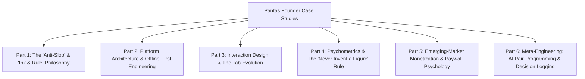

# Building Pantas: A Solo Founder & Developer Case Study Series
*Master outline, decision index, and research dossier blueprint for Aedwon's personal blog.*

---

## Overview & Purpose

This document outlines a multi-part, retrospective case-study series for [aedwon.com](https://aedwon.com) (or personal website). It records the raw, unvarnished decision-making process behind designing, engineering, and launching **Pantas**—a high-craft standardized exam review platform for Filipino students (Civil Service Exam, College Entrance Tests, PSHS-NCE, and Licensure Exams).

### Core Narrative Themes
1. **The Anti-AI-Slop Stance:** Rejecting the generic, pastel, pill-heavy "vibe-coded" aesthetics that dominate AI-assisted projects in favor of *Ink & Rule*—a dense, printed-workbook editorial craft.
2. **"Never Invent a Figure":** The foundational psychometric and ethical principle banning synthetic score predictions, opaque readiness metrics, or deceptive proxies.
3. **Local-First & Offline-First Engineering:** Building for Philippine network realities using Flutter, Drift (SQLite), and pure Dart implementations of spaced repetition (FSRS).
4. **Monetization with Integrity:** Designing transparent paywalls with zero surprise renewals, resolving 3 distinct gate mechanics, and pricing for local purchasing power parity (₱29 weekly SKU).
5. **Meta-Engineering with AI:** Managing 90+ implementation plans, subagent execution workflows, and logging every rejected option verbatim.

---

## Series Master Structure

---

## Part 1: The "Anti-AI-Slop" Manifesto & The Birth of *Ink & Rule*

### 1. Hook & Premise
In mid-2026, AI-generated code produced a visual monoculture: Poppins bold fonts, stock Tailwind blue (`#1F6BFF`), nested cards with drop shadows, emoji-as-icons, and pastel pills. Pantas stripped all of it away in a total design revolt on July 18, 2026, replacing it with an editorial printed-workbook identity.

### 2. Key Decisions & Contrarian Points
* **The "Vibe-Coding" Trap:** Why default AI outputs create interfaces that feel cheap, noisy, and distracting for high-stakes study.
* **Paper & Ink Palette:** Warm paper surfaces (`#FBF9F4`), near-black ink (`#26221B`), and 1px hairline rules (`#E5DFD3`) replacing cards and shadows.
* **Typography Discipline:** Replacing dynamic Google Fonts with bundled static assets: **Source Serif 4** (display & numbers) and **Source Sans 3** (data & body).
* **The Strict Color Budget:** Board Green (`#1D5C50`) strictly budgeted for the *single* primary action per screen. Semantic colors (`rust #A33B2E`, `amber #9A6B15`) strictly reserved for score thresholds, never decoration.
* **Component System:** Building `lib/core/ui/components/` (`PageScaffold`, `SectionHeader`, `RuledSection`, `InkTableRow`, `StatsBand`, `ProgressRule`) to permanently ban hand-styled card slop.

### 3. Primary Sources & Grounded Repo Anchors
* **Specs:** [`docs/superpowers/specs/2026-07-18-ui-redesign-design.md`](file:///Users/aedwon/Documents/Projects/Pantas/docs/superpowers/specs/2026-07-18-ui-redesign-design.md)
* **Plans:** [`docs/superpowers/plans/2026-07-18-ink-and-rule-foundation.md`](file:///Users/aedwon/Documents/Projects/Pantas/docs/superpowers/plans/2026-07-18-ink-and-rule-foundation.md), [`docs/superpowers/plans/2026-07-19-ink-and-rule-feature-sweep.md`](file:///Users/aedwon/Documents/Projects/Pantas/docs/superpowers/plans/2026-07-19-ink-and-rule-feature-sweep.md)
* **Rules & Constraints:** [`CLAUDE.md`](file:///Users/aedwon/Documents/Projects/Pantas/CLAUDE.md), [`AGENTS.md`](file:///Users/aedwon/Documents/Projects/Pantas/AGENTS.md)

---

## Part 2: Platform Architecture & Offline-First Engineering

### 1. Hook & Premise
Building a mobile app for Filipino students means designing for spotty data, battery conservation, and high latency. Pantas is engineered as an offline-first, zero-latency local appliance.

### 2. Key Decisions & Technical Deep Dive
* **The Stack:** Flutter + Drift (SQLite) + Riverpod + Firebase Auth/Sync.
* **Pure Dart FSRS (Free Spaced Repetition Scheduler):** Implementing memory stability and retrievability algorithms locally on SQLite, without leaking algorithm jargon to users.
* **The Dual-Content Evolution:** The architectural transition from dynamic Sanity CMS remote fetching to an immutable, pre-compiled static SQLite seed (`content.db` / `assets/seed/v1.json`) with zero network dependency during study sessions.
* **Custom In-House Tooling:** Building the **Lesson Author Tool**, **Static Question Pipeline**, and **Illustration Studio** (SVG question figures) to maintain quality at scale.

### 3. Primary Sources & Grounded Repo Anchors
* **Specs:** [`docs/superpowers/specs/2026-08-03-offline-and-network-posture-design.md`](file:///Users/aedwon/Documents/Projects/Pantas/docs/superpowers/specs/2026-08-03-offline-and-network-posture-design.md), [`docs/superpowers/specs/2026-07-20-static-question-pipeline-design.md`](file:///Users/aedwon/Documents/Projects/Pantas/docs/superpowers/specs/2026-07-20-static-question-pipeline-design.md), [`docs/superpowers/specs/2026-08-03-content-delivery-and-seed-upgrade-design.md`](file:///Users/aedwon/Documents/Projects/Pantas/docs/superpowers/specs/2026-08-03-content-delivery-and-seed-upgrade-design.md)
* **Plans:** [`docs/superpowers/plans/2026-05-09-plan-04-fsrs-engine.md`](file:///Users/aedwon/Documents/Projects/Pantas/docs/superpowers/plans/2026-05-09-plan-04-fsrs-engine.md), [`docs/superpowers/plans/2026-05-09-plan-03-local-data-layer.md`](file:///Users/aedwon/Documents/Projects/Pantas/docs/superpowers/plans/2026-05-09-plan-03-local-data-layer.md)

---

## Part 3: Interaction Design & The Tab Evolution

### 1. Hook & Premise
Behind every clean screen lies a graveyard of discarded mockups, tested hypotheses, and hard-fought arguments between founder and AI.

### 2. Key Decisions & Tab Breakdown
* **Onboarding & The Age Gate:** Navigating RA 10173 (Philippine Data Privacy Act) compliance vs Grade 6 PSHS-NCE students; capturing name & exam date *after* exam selection to build psychological investment.
* **Quiz Tab — The Hub vs The List:** Why topic queues were abandoned for the Assessment Hub; designing the Answer Reveal to highlight *distractor misconception explanations* rather than simple correctness.
* **The Confidence Rating Experiment (Killed):** Testing the hypercorrection effect ("How sure are you?") and rejecting it because cognitive friction outweighed the theoretical learning gain.
* **Study Tab & The Expanding Map:** Deleting separate topic detail routes in favor of an in-place expanding hierarchical tree; reader typography with explicit endings.
* **Mock Exam Simulation:** Recreating physical paper exam pressure with boundary timers, question pennants, and debriefing flows.

### 3. Primary Sources & Grounded Repo Anchors
* **Decision Logs:** [`docs/superpowers/decisions/2026-07-28-quiz-tab-decision-log.md`](file:///Users/aedwon/Documents/Projects/Pantas/docs/superpowers/decisions/2026-07-28-quiz-tab-decision-log.md), [`docs/superpowers/decisions/2026-08-02-onboarding-name-and-date-log.md`](file:///Users/aedwon/Documents/Projects/Pantas/docs/superpowers/decisions/2026-08-02-onboarding-name-and-date-log.md), [`docs/superpowers/decisions/2026-08-02-study-tab-planning-log.md`](file:///Users/aedwon/Documents/Projects/Pantas/docs/superpowers/decisions/2026-08-02-study-tab-planning-log.md)
* **Specs:** [`docs/superpowers/specs/2026-07-26-home-and-navigation-design.md`](file:///Users/aedwon/Documents/Projects/Pantas/docs/superpowers/specs/2026-07-26-home-and-navigation-design.md), [`docs/superpowers/specs/2026-07-27-study-tab-and-reader-design.md`](file:///Users/aedwon/Documents/Projects/Pantas/docs/superpowers/specs/2026-07-27-study-tab-and-reader-design.md), [`docs/superpowers/specs/2026-07-28-quiz-tab-design.md`](file:///Users/aedwon/Documents/Projects/Pantas/docs/superpowers/specs/2026-07-28-quiz-tab-design.md)

---

## Part 4: Psychometrics & The Rule: "Never Invent a Figure"

### 1. Hook & Premise
Most EdTech apps display fabricated metrics: "Exam Readiness: 87%" or "Passing Probability: 92%". Pantas instituted an unyielding ethical constraint: **Never Invent a Figure**.

### 2. Key Decisions & Analytical Integrity
* **Section 1 of Progress Spec:** A number must be directly measured from student use, published by the official testing body, or output by a named algorithm. Inferred or synthetic proxy figures are banned.
* **Score Impact as Delta, Never Total:** Showing "Fixing these 3 weak topics is worth +9 points", but never fabricating an overall predicted exam percentage.
* **The 4 Charters of the Progress Tab:**
  1. *The Diagnosis (B):* Where are points leaking and why?
  2. *The Mirror (C / How You Work):* Real behavioral archetypes (stamina drop-off, speed under time pressure, flag discipline).
  3. *The Record (A):* Concrete history and movement.
  4. *What's Fading (D):* FSRS memory decay curve visualization.
* **Filipino Vocabulary Alignment:** Enforcing "Points" instead of "Marks" across all copy (because "marks" does not match Philippine educational vernacular).

### 3. Primary Sources & Grounded Repo Anchors
* **Specs:** [`docs/superpowers/specs/2026-07-30-progress-tab-design.md`](file:///Users/aedwon/Documents/Projects/Pantas/docs/superpowers/specs/2026-07-30-progress-tab-design.md), [`docs/superpowers/specs/2026-06-10-user-facing-metrics-design.md`](file:///Users/aedwon/Documents/Projects/Pantas/docs/superpowers/specs/2026-06-10-user-facing-metrics-design.md)
* **Decision Logs:** [`docs/superpowers/decisions/2026-07-29-progress-tab-decision-log.md`](file:///Users/aedwon/Documents/Projects/Pantas/docs/superpowers/decisions/2026-07-29-progress-tab-decision-log.md)

---

## Part 5: Emerging-Market Monetization & Paywall Psychology

### 1. Hook & Premise
Monetizing EdTech in Southeast Asia requires balancing low purchasing power with sustainable unit economics. Predatory subscription traps destroy trust; transparency builds it.

### 2. Key Decisions & Business Strategy
* **Resolving the 3 Gate Collisions:** Consolidating 5 diverging specs into three clear rules:
  1. *Pro Interprets:* Free sees the record; Pro sees the diagnostic meaning.
  2. *Pro Gets the Instrument:* Free gets the answer; Pro gets the full sortable, deep analytics table.
  3. *Pro Lifts Volume Caps:* Unlimited mock exams (Free capped at 1 every 14 days).
* **The ₱29 Weekly SKU:** A self-liquidating, low-friction micro-commitment tailored to Philippine student allowance cycles.
* **The "Transparency Bias" Paywall:** Day 0 / Day 5 / Day 7 disclosure timelines for yearly trials with automatic reminders before charging.

### 3. Primary Sources & Grounded Repo Anchors
* **Decision Logs:** [`docs/superpowers/decisions/2026-08-02-paywall-consolidation-log.md`](file:///Users/aedwon/Documents/Projects/Pantas/docs/superpowers/decisions/2026-08-02-paywall-consolidation-log.md)
* **Specs:** [`docs/superpowers/specs/2026-08-03-paywall-pricing-and-flow-design.md`](file:///Users/aedwon/Documents/Projects/Pantas/docs/superpowers/specs/2026-08-03-paywall-pricing-and-flow-design.md), [`docs/superpowers/specs/2026-07-18-weekly-sku-pricing-amendment-design.md`](file:///Users/aedwon/Documents/Projects/Pantas/docs/superpowers/specs/2026-07-18-weekly-sku-pricing-amendment-design.md)
* **Future Projections:** [`docs/future/2026-07-25-year-1-user-and-revenue-projection.md`](file:///Users/aedwon/Documents/Projects/Pantas/docs/future/2026-07-25-year-1-user-and-revenue-projection.md)

---

## Part 6: Meta-Engineering: AI Pair-Programming & Decision Logging

### 1. Hook & Premise
How does a sole founder design, architect, write, and execute a massive codebase without losing control of craft or introducing architectural rot?

### 2. Key Decisions & The System
* **The Division of Labor:** Brainstorm $\rightarrow$ Spec $\rightarrow$ Plan $\rightarrow$ Subagent Execution $\rightarrow$ Verification.
* **"Record Every Decision at Every Revision":** The discipline of logging every wrong turn, rejected plate, and verbatim founder quote as it happened.
* **Managing Subagents at Scale:** Executing 90+ implementation plans with strict analyzer gates (`very_good_analysis`, strict casts/inferences, zero AI attribution).
* **Landmines & Hard Lessons:** Documenting unannounced landmines (router quirks, database dual paths, missing blueprint dependencies) to keep AI models grounded.

### 3. Primary Sources & Grounded Repo Anchors
* **Guidelines & Contracts:** [`CLAUDE.md`](file:///Users/aedwon/Documents/Projects/Pantas/CLAUDE.md), [`AGENTS.md`](file:///Users/aedwon/Documents/Projects/Pantas/AGENTS.md), [`SUBAGENTS.md`](file:///Users/aedwon/Documents/Projects/Pantas/SUBAGENTS.md)
* **Execution Logs:** [`docs/superpowers/decisions/2026-08-04-execution-dispatch-log.md`](file:///Users/aedwon/Documents/Projects/Pantas/docs/superpowers/decisions/2026-08-04-execution-dispatch-log.md), [`docs/superpowers/2026-08-03-launch-checklist.md`](file:///Users/aedwon/Documents/Projects/Pantas/docs/superpowers/2026-08-03-launch-checklist.md)

---

## Workflow for Drafting Individual Posts

When you are ready to write a post:
1. **Specify the Part** (e.g., *"Let's prepare Part 1 on Ink & Rule"* or *"I want to draft Part 4 on Psychometrics"*).
2. **I will generate a Grounded Research Dossier** containing:
   * Verbatim founder quotes from the corresponding decision log.
   * Specific numbers, color tokens, and exact algorithmic constraints.
   * The rejected alternatives and stated costs.
   * A structured narrative drafting prompt tailored for your personal website.
