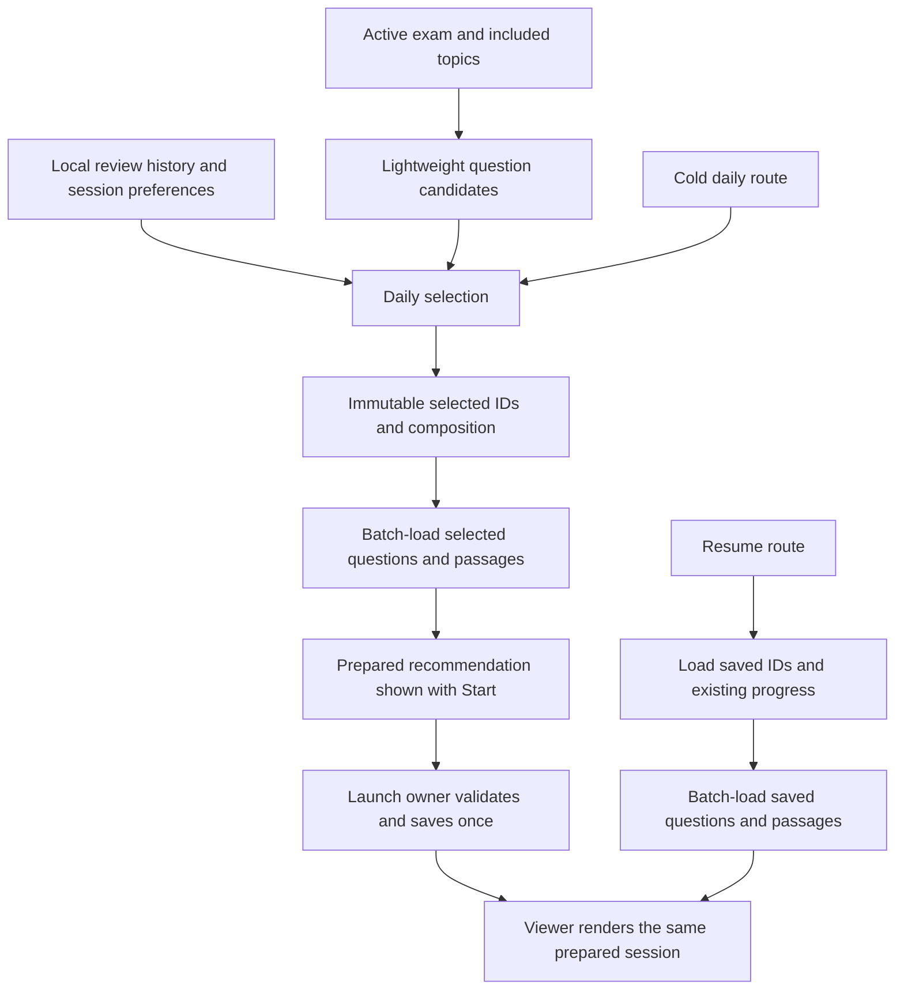

# Daily quiz loading on lower-end Android

Date: September 6, 2026  
Status: Proposed spec for review. Balanced scope selected by Aedwon.  
Deliverable: Specification only. No implementation plan or application changes.  
Code inspected: `3a1ac087`, with a clean working tree before this document.

## 1. Problem and intended experience

Aedwon reported two noticeable waits on a physical Android phone:

1. The recommended daily quiz takes time to appear.
2. Opening the quiz shows another loading state before answering can begin.

The phone model, build mode, and durations are unknown. His priority is broader
than improving one phone:

> i don't know actually. but the goal here is that it should feel the same in lower-end devices as the app is for the masses so... optimizations are needed

Lower-end Android is the acceptance platform. The app should respond promptly,
prepare only the content needed, and open a complete, answerable question.
Faster devices must not be the only devices on which the experience feels ready.

“Generation” here means selecting authored questions from local storage. The
inspected daily-start path does not generate questions with AI or request them
from a server. Fixing these waits does not require a generation service.

The main surface investigated is the Quiz tab's “Today's session” panel. Home's
topic practice entrance also opens the daily route and is included at that
boundary. Home's “Up next” panel recommends lessons and is a different flow.

## 2. Scope

Included:

- Recommendation data access and selection preparation.
- Reusing the displayed recommendation when Start is tapped.
- One owner for launch, persistence, and the handoff to the viewer.
- Complete question readiness, including passages and required diagrams.
- Relevant cache freshness, cancellation, retry, and duplicate-start behavior.
- Batched hydration shared by new daily sessions and resumed sessions.
- Local performance measurements and acceptance on lower-end Android.

Excluded:

- A new learning algorithm, new ordering proportions, or new daily limits.
- A mock-exam redesign, study-plan redesign, or general Home optimization.
- Remote question generation, persistent recommendation caches, background
  services, a new state-management framework, or new analytics infrastructure.
- A full answer-history or account-storage migration.
- Implementation tasks, schedules for building the change, and application code.

Existing quiz appearance, Free/Pro behavior, local content delivery, question
identity, and saved history remain constraints. Use the existing Ink and Rule
components and Source Sans 3.

## 3. Findings and evidence

These findings establish unnecessary work and broken handoffs. They do not
establish how many milliseconds each part takes on the reported phone.

### 3.1 Recommendation prepares complete questions for the entire scope

`todayInputsProvider` obtains scoped topics, then awaits `questionsByTopic` for
each topic in sequence. Each question is hydrated with its choices, exam tags,
stem, explanation, rationale, and figure data before the recommendation exists.

`ContentRepository._hydrateQuestion` performs two additional SQL queries per
question: one for choices and one for exam membership. `Future.wait` overlaps
the requests inside a topic but does not remove these queries. Even
`questionsByIds`, despite its batching comment, still invokes this per-question
hydration.

The bundled database inspected in this checkout contains:

| Measurement | Value |
|---|---:|
| Active questions | 2,361 |
| Choice rows | 9,459 |
| UPCAT topic-owned questions / topics | 1,968 / 16 |
| CSE Professional topic-owned questions / topics | 393 / 10 |
| Questions with a passage reference | 160 |
| Questions with figure data | 111 |

These are local asset measurements, not verified counts on Aedwon's phone.
Topic-owned counts describe the current topic-loading path, not a separate
audit of question exam tags.

For an unexcluded UPCAT scope, the code implies **3,952 content SELECTs** for
topic question hydration alone: 16 topic queries plus twice 1,968 questions.
This excludes scope lookup, history, preferences, and session queries. It is a
count derived from the code and asset, not a captured device trace.

SQLite `EXPLAIN QUERY PLAN` against the read-only asset reports:

- Choice lookup by question: `SCAN content_choices`, plus a temporary B-tree
  for ordering.
- Active question lookup by topic: `SCAN content_questions`.

The asset has primary-key indexes on these tables but no supporting index for
either lookup. Repeating a full choice-table scan for every question is a
concrete source of avoidable database work.

### 3.2 Start discards the recommendation's prepared selection

The available panel holds a `TodaySessionPlan` with complete questions. Its
Start callback passes through the study-first nudge and pushes an exam route.
Neither the normal callback nor “Start quiz anyway” passes the plan.

`QuizPage.initState` starts a new daily session after its first frame.
`QuizController.startToday` supports a plan argument, but this caller supplies
none. `StartTodaySession` therefore loads the topic or exam again and runs its
content-only fallback, with empty due and weakness inputs.

Consequences:

- The viewer repeats the expensive question-loading work.
- The questions can differ from the recommendation the student saw.
- The fallback does not use the recommendation's scoped-topic resolution,
  history, or remaining new-question allowance.

The comment saying “The Quiz tab always supplies a plan” is contradicted by the
current call sites. A unit test proves the use case accepts a supplied plan;
it does not prove the UI supplies one.

### 3.3 Home performs two starts

Home's topic practice row calls `StartTodaySession`, receives a persisted
session, discards that session object, and pushes the daily route. The viewer
then starts again. Home uses `local_user`; the controller and daily panel use
`local`. This is both redundant preparation and an inconsistent session owner.

### 3.4 “Running” does not mean the question is complete

The viewer independently requests a passage using `passageByIdProvider` after
entering `QuizRunning`. It reads `valueOrNull`, treating pending and failed
loads like a question without a passage. Choices can be active before the
passage arrives.

Question figures are decoded and constructed during widget build. They are
local drawings in the inspected renderer, not remote image downloads. Their
rendering cost, and math layout cost, need frame measurements. Neither is
proven to be the dominant delay.

The controller captures `questionShownAt` before awaiting session preparation.
The first answer's response duration therefore includes loading time. This
also affects the rating heuristic that consumes response duration.

### 3.5 Supporting work and lifecycle issues

- Every topic scans the review-state list and recreates the seen-question set.
  Recent attempt JSON is decoded to build weakness inputs. These are plausible
  CPU costs that need separate timing.
- Custom-track topic resolution hydrates questions just to compare topic
  counts, before daily preparation loads questions again.
- The panel waits for the optional historical average before becoming available.
- The daily providers cache futures, but the inspected quiz flow explicitly
  invalidates the panel only on Discard. Repository objects do not themselves
  make these one-shot reads react to answers, settings changes, or midnight.
- A failure inside the session panel hides it. The viewer's Retry always
  calls quick-quiz start, even if the failed request was Today or Resume.
- The shared controller has no launch-generation check. A late result can
  replace newer state after navigation or another launch.

The content database already opens through `NativeDatabase.createInBackground`.
“Move SQLite off the UI thread” alone is not a solution to this query pattern.

## 4. Recommended architecture

Use a lightweight daily selection followed by batched preparation of the
selected session. Keep a single prepared result through launch and rendering.

| Approach | Cost and limitation |
|---|---|
| Batch full-scope hydration and pass the existing plan | Smallest change. Removes query multiplication and the second start, but still decodes and retains every candidate's full content. |
| **Lightweight selection, selected-content hydration, one launch owner** | Recommended. Changes the selection input boundary and launch handoff. Bounds full-content work by session size and addresses both waits. |
| Persistent precomputed sessions and background regeneration | Adds storage, invalidation, process scheduling, and recovery complexity. Unnecessary for this scope. |

The diagram describes responsibilities, not a required class hierarchy or
sequence of implementation tasks.

### 4.1 Content access

The repository exposes a lightweight selection projection containing the
identity, topic, version, passage membership, and other fields actually used
by eligibility and ordering. It must not fetch choices, explanations,
rationales, or figure payloads for questions that are not selected.

Scope resolution must use counts or metadata when it needs counts. Custom
tracks must not hydrate the whole corpus to decide which topics exist.

Selected content is hydrated with set-based queries for question rows, active
choices, exam membership, and distinct passages. Group child rows in memory.
Preserve deterministic choice ordering and the selected question order.
Calling an existing bulk method that still queries twice per row does not
satisfy this requirement.

Queries must respect SQLite parameter limits through bounded chunks. Query
counts may grow with chunk count, but not with an extra pair of queries for
every question. No unbounded `Future.wait` over individual question reads.

Supporting indexes must cover the actual topic/active and
question/active/choice-order predicates. Verify their use against the shipping
asset. Both newly installed and upgraded content databases must receive the
indexes. A faster development database alone is insufficient.

Content stays in `ContentDatabase`; personal state stays in `AppDatabase`.
Do not move user records or reintroduce the retired JSON runtime content path.

### 4.2 Selection and preparation

Capture one consistent input snapshot for the effective exam scope,
preferences, history, and current time. Group relevant review states and
outcomes once. Fetch independent local inputs concurrently where useful,
without flooding one database connection with per-row requests.

Keep selection pure and independent of Flutter and SQL. Its output contains
ordered question IDs, question versions, the named topic, and the composition
used by the panel. Preserve the existing selection rules during the change
to metadata inputs. Do not substitute SQL randomness or a new distribution.

Hydrate the selected questions and their distinct passages before publishing
an actionable recommendation. Keep this prepared content in memory for the
handoff. Do not create a persistent quiz session during preview preparation.

The panel may show its heading and loading treatment immediately. “Start” is
enabled only when the prepared result is ready. Optional historical average
minutes must not delay readiness; show the measured value when available,
under the existing seven-completed-session rule.

The final order must include any required passage grouping before it is
presented as the selected session. Persist and display that same order.

### 4.3 One launch owner

A quiz application-layer operation owns preparation, validation, session
creation, and the ready result. Home and Quiz call that operation. They must
not reach into each other's presentation state.

- A warm daily launch consumes the prepared recommendation. It does not load
  the entire scope or run the selector again while that snapshot is valid.
- The study-first nudge keeps the same launch intent. After the student
  dismisses it, freshness is checked again before committing the session.
- A cold daily route prepares through the same daily logic. It must not fall
  back to treating the entire bank as new questions.
- A topic launch carries its requested topic scope through preparation and
  rendering. Home must not save a session and then ask the viewer to create
  another one.
- Resume reads the saved session identity and order. It never invokes new
  daily selection or substitutes a quick quiz.
- In-memory handoffs are keyed to the intended session. A viewer must not
  render whichever unrelated session happens to occupy a global controller.

Use the established local session identity consistently across Home and Quiz.
Any repair of historical rows written under different owner strings requires
a separate, explicit data decision. Do not rewrite history as a performance fix.

Only one start may be in flight for the same launch intent. Repeated taps
join that operation or are disabled. Rebuilding or reopening the route must
not create another session. Replacing an open session must be atomic, so a
failed insert does not discard the previous resumable session.

If the student leaves before persistence starts, abandon the launch. If the
save has already committed, keep that one session resumable and suppress late
navigation. A stale async result must not overwrite a newer launch.

### 4.4 Question readiness

An answerable question has its stem, choices, required passage, and required
diagram ready. A required passage cannot be treated as absent while loading.

For a normal daily session, keep all selected questions and distinct passages
ready in memory. Moving to Next must not trigger another content-database
load. Long “all due” sessions may use bounded hydration chunks during initial
preparation, but must not silently shorten the selected session for speed.
Render only the visible question, not a hidden widget tree for every question.

A missing or invalid required resource produces a retryable content error.
Do not enable answers or silently replace the affected question. If content
changes invalidate an unstarted recommendation, prepare and show a new
recommendation before accepting another Start.

Start response timing when the complete question is first presented and
answerable. Exclude session loading and passage loading. Rebuilds, flag
updates, and optional average updates must not restart the question's timer.
Do not change previously recorded response times.

### 4.5 Freshness and memory

Reuse prepared data only within the same user-data lifetime, exam/topic scope,
content revision, session preferences, and relevant history state.

Invalidate or revalidate on:

- Answer and assessment changes, completed or discarded sessions, and imported
  history that changes eligibility.
- Exam switching, topic exclusions, or session-building preferences.
- Content installation/replacement and account switch, reset, or data wipe.
- Local day rollover and relevant due-time/window boundaries, including when
  returning from the background.

A cached function returning “now” is not a clock invalidation mechanism.
Use existing state notifications and explicit freshness checks. This spec
does not require a new persistent revision/event subsystem.

At Start, cheaply validate freshness. A stale recommendation returns to
preparation and refreshes the panel; it must not silently launch different
questions under the old counts. Once started, the selected session is stable
and ordinary history updates must not regenerate it.

Keep lightweight candidates only for the active scope and full content only
for the active/prepared session. Release obsolete preparations and old scope
caches. Repeated tab switching must not retain another full bank each time.

### 4.6 Loading and errors

Use one continuous preparation state per launch. Do not show a finished
recommendation, navigate, and restart full-bank loading behind empty chrome.
Moving the same wait ahead of navigation is not sufficient; total latency
must also meet the budgets below.

Loading keeps Back and ordinary navigation responsive. Use the existing
static `FaintBars` and a short accessible status such as “Getting your quiz
ready.” No shimmer, fake percentages, or artificial minimum loading duration.

Errors stay visible in the existing error component. Suggested copy:

- Recommendation: “Could not load your quiz. Try again.”
- Preparation: “Could not open your quiz. Try again.”
- Required content: “Part of this question could not load. Try again.”

Retry repeats the original mode, scope, and session intent. It must distinguish
an uncommitted preparation from an already saved session to avoid duplicates.
Do not print raw exceptions. An empty eligible pool is an empty state, not a
network error or an infinite loading state.

Quiz preparation must work offline from installed content. Optional telemetry,
remote sync, mock availability, flag summaries, and unrelated panels must not
be awaited by the daily readiness operation. Address any measured contention
at its source without hiding the rest of the tab behind the daily load.

## 5. Performance requirements

These are **proposed engineering budgets**, not measured current performance
or figures to display to students. Lower-end hardware must meet the absolute
budgets. Identical millisecond timings across different hardware are not a
realistic requirement.

| Scenario | Proposed acceptance budget |
|---|---:|
| Visible feedback after Start or Retry | Within 100 ms |
| First recommendation after active exam and installed databases are available, including topic-scope resolution | p95 at most 1,000 ms |
| Return to an unchanged prepared recommendation | Next usable frame; no database preparation |
| Start from a valid prepared recommendation to complete answerable question | p95 at most 500 ms |
| Cold daily route to complete answerable question, after app bootstrap | p95 at most 1,500 ms |
| Resume of a normal 5, 10, or 20-question session | p95 at most 1,000 ms |
| Next question with content already prepared | p95 at most 100 ms |

Measure initial installation and app bootstrap separately and also report
launch-to-answerable end-to-end time. The preparation budgets must not be met
by moving expensive work into unreported bootstrap or scope resolution.

On a 60 Hz reference device, target p95 UI build and raster durations within
the 16.7 ms frame budget during the transition. Report missed frames as well.
No synchronous selection, decode, or preparation block may make navigation
unresponsive for 100 ms. Additional isolate work is justified only by a trace
showing remaining CPU work after query multiplication is removed.

Large sessions must retain responsive controls and report their actual latency
separately. They must not cause memory termination or retain full-bank widget
trees. Compare retained memory before and after repeated launch/leave cycles;
there must be no accumulating session or exam cache growth.

## 6. Measurement and acceptance evidence

### Device measurements

Use a physical lower-end Android phone as the primary reference, preferably
an existing entry-level device with 3–4 GB RAM and a 60 Hz screen. Record its
actual model, Android version, chipset, RAM, build mode, app revision, content
revision, and history fixture. Use a mainstream phone as a comparison.
No specific phone was available during this investigation; `adb devices -l`
returned an empty list.

Use profile measurements for stage and frame attribution, then verify the
user experience in release. Debug timing is diagnostic and cannot pass or
fail release performance on its own.

Record at least 30 observations for each ordinary launch scenario and report
median, p95, and maximum. Separate cold process runs from warm repeats. Keep
device power/thermal conditions and history fixtures comparable. Include:

- UPCAT, CSE Professional, and a narrowed custom track.
- Normal session lengths and the existing “all due” option.
- Empty history, mixed due/weak/new history, and substantial review history.
- Plain text, math, passage, and diagram questions, including as question one.
- Offline operation, app background/return, day rollover, and content upgrade.

Capture local spans for scope resolution, metadata reads, history reads and
decode, selection, selected hydration, passage readiness, session persistence,
route presentation, and the first complete answerable frame. Record actual
query counts and candidate/selected counts with these spans.

Local diagnostic traces are sufficient. This spec authorizes no new uploaded
analytics or changes to consent. Diagnostics must not include question text,
student answers, or personal identifiers.

### Behavioral acceptance

- The UI-to-session test follows the real Start route, including both nudge
  paths. The prepared IDs, displayed composition, persisted IDs, and viewer
  IDs agree. Passage grouping must not introduce a second order at persistence.
- A warm start performs no full-scope content reload or repeated selection.
- Metadata selection performs no per-question choice or exam-tag hydration.
  Selected hydration uses a bounded number of set queries per chunk.
- Home topic practice creates one session under the same local owner used by
  the daily panel. It opens that session without a second start.
- Retry preserves Today/Resume/topic intent. Rapid taps, route rebuilds,
  navigation away, and late async completion create no extra sessions.
- Required passage or diagram failure never exposes active choices with
  incomplete context. Next does not cause a content loading state.
- The first response duration excludes deliberately delayed preparation.
- Relevant settings, scope, history, content, and day changes invalidate stale
  preparations. Unrelated rebuilds reuse a valid preparation.
- Opening the panel alone writes no session and consumes no new-question
  allowance. A failed start preserves any previous resumable session.
- Shared repository changes retain choice order, rationale, figure data,
  question versions, and saved-session order. Existing consumers remain valid.

These are acceptance conditions, not an implementation task list. Performance
sign-off requires device evidence; unit tests alone cannot provide it.

## 7. Related defects and boundaries that must stay explicit

The investigation found existing correctness gaps around selection and saved
sessions. They must not be concealed by a faster loading path:

1. **Ordering preferences disagree.** Settings writes
   `settings.session_ordering`; quiz preferences read `quiz_today_interleaved`.
   The August 3 amendment already designates the Settings value as the source.
   Preparation and launch must use the same effective preference. Any legacy
   fallback must not override an explicit current Settings choice.
2. **Interleaved tail and fully mixed currently share a picker.** The July
   seven-from-topic/three-from-elsewhere rule is already recorded as unfinished
   in the August 2 plan and decision log. This performance spec does not
   redesign those proportions.
3. **The fallback can escape the three counted buckets.** `TodayTopicPicker`
   fills from `allQuestions`; `BuildTodayPlan` counts only IDs in its three
   input buckets. Applying the cap separately per topic can also exceed the
   intended exam-wide allowance. Do not relabel unclassified questions as
   “new” to force counts to add up. These selection-policy cases require an
   explicit ruling before claiming complete recommendation correctness.
4. **Resume loses in-memory outcomes.** The current resume use case restores
   saved IDs and position with an empty outcomes list. Batched hydration does
   not repair answer-history reconstruction. Do not claim that speeding up
   Resume fixes this separate persistence defect.
5. **Completion is not wired to the session row in the inspected path.**
   `CompleteQuiz` saves an attempt but does not call the repository's session
   completion method. Fresh panel reads can therefore expose an old session.
   Terminal session state must be correct before freshness acceptance is
   signed off. Merely invalidating the provider is insufficient.

Items 2–4 are separate selection/history decisions, not permission to expand
this into a learning-engine or storage rewrite. Items 1 and 5 are direct
integration dependencies for the proposed freshness contract. The spec can
be reviewed now; unresolved dependencies must be stated when future work is
scoped, not hidden in implementation.

## 8. Evidence references and validation performed

Primary code references, relative to the repository root:

| Area | Files |
|---|---|
| Recommendation gathering and panel states | `lib/features/quiz/presentation/today_providers.dart` |
| Panel and nudge launch | `lib/features/quiz/presentation/widgets/session_panel.dart`, `lib/features/quiz/presentation/quiz_tab_home.dart` |
| Viewer, readiness, retry, and timing | `lib/features/quiz/presentation/quiz_page.dart`, `lib/features/quiz/presentation/quiz_controller.dart` |
| Start and resume | `lib/features/quiz/domain/use_cases/start_today_session.dart`, `lib/features/quiz/domain/use_cases/resume_session.dart` |
| Selection and bucket accounting | `lib/features/quiz/domain/use_cases/build_today_plan.dart`, `lib/features/quiz/domain/use_cases/count_today_backlog.dart`, `lib/features/quiz/domain/picker/` |
| Database access and opening | `lib/core/storage/data/repos/content_repository.dart`, `lib/core/content/content_database_opener.dart` |
| Scope and Home entrance | `lib/core/storage/track_scope.dart`, `lib/features/home/presentation/widgets/practice_panel.dart` |
| Session writes and completion | `lib/features/quiz/data/repos/quiz_session_repository.dart`, `lib/features/quiz/domain/use_cases/complete_quiz.dart` |
| Ordering sources | `lib/features/quiz/data/repos/quiz_preferences_repository.dart`, `lib/features/settings/data/settings_repository.dart` |
| Rendering | `lib/core/ui/components/question_card.dart`, `lib/core/ui/figures/question_figure.dart` |

Existing design sources:

- [Quiz design](2026-07-28-quiz-tab-design.md), especially the session panel,
  composition, and viewer requirements.
- [Session-panel plan](../plans/2026-08-02-quiz-tab-02b-session-panel.md), including
  its August 3 settings amendment and its explicitly deferred picker rules.
- [Viewer plan](../plans/2026-08-02-quiz-tab-04-viewer-and-reveal.md).
- [Quiz decisions](../decisions/2026-07-28-quiz-tab-decision-log.md), including the
  August 2 ruling on measured average duration and topic-level weakness.
- [Content-path design](2026-08-11-content-path-and-the-mock.md),
  [reader migration plan](../plans/2026-08-11-content-02-the-app-reads-the-content-database.md),
  and [migration repair findings](../decisions/2026-08-11-content-02-repair-log.md).
- [Layering decision](../decisions/2026-08-10-layering-rule-log.md).

Validation completed for this investigation:

- Read the live recommendation-to-viewer flow and the relevant design records.
- Inspected the bundled database read-only, including row counts, existing
  indexes, and query plans. The asset was not modified.
- Ran the existing panel-provider, daily-start, resume, and daily-plan test
  files: **20 tests passed**. These small-fixture tests do not cover the real
  UI handoff or demonstrate acceptable phone performance.
- No device benchmark, implementation, seed rebuild, or full application
  regression run was performed for this specification-only task.

## 9. Decision record for this spec

Kept in this document so the requested output remains one specification.

The offered scope choices were Minimal (two visible waits, 10–15 minutes of
investigation), Balanced (both delays and targeted architectural requirements,
20–30 minutes), and Hardened (broader instrumentation and failure handling,
40–60 minutes). These were investigation estimates, not implementation estimates.

Aedwon selected:

> Balanced: inspect both delays and specify targeted improvements (20–30 minutes)

He subsequently made lower-end devices the priority, quoted in Section 1.
The recommended architecture and budgets are proposals in this document.
Selecting Balanced did not approve application changes or resolve the older
selection-policy gaps. No implementation plan is part of this deliverable.
