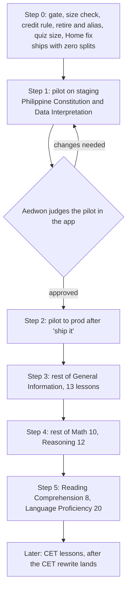
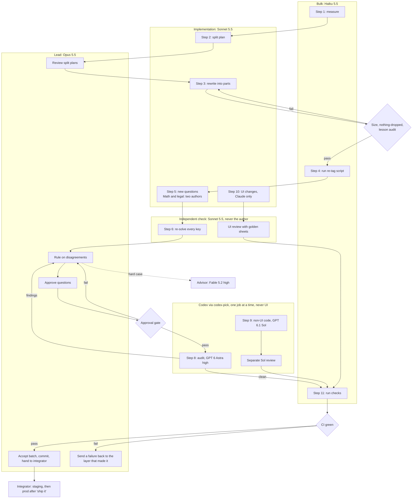
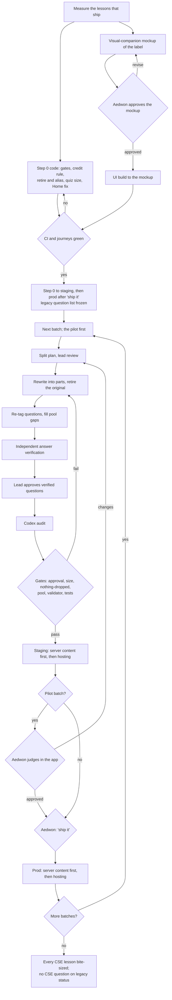
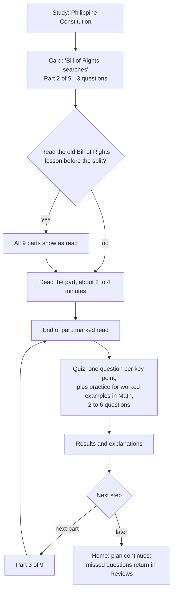

# Bite-sized lessons and quiz size that follows the lesson

Status: design spec, waiting for Aedwon's approval of Part A. Nothing is built.
Approving Part A does not approve the UI rows in B7 or decision 2: those are approved with the
visual-companion mockup, which WORKFLOW.md requires before UI is approved.
Date: November 13, 2026. Lane: Bite-sized lessons spec (lead, Opus 5.5).
Policy revision read: `origin/main` 8f0799372 (AGENTS.md, WORKFLOW.md, SUBAGENTS.md,
`docs/workflow/orchestrator.md`, `docs/workflow/operations-manager.md`).
Content measured: `content/cse-rewrite-r1` 1ca8dfd0c (what prod serves) and `main` 1ac7d2f3f.
Velocity row: E-042. Reviewed once by Fable 5.2 high; its findings are applied (B14).

Aedwon's request, verbatim: "i think some lessons are still too long. i want every lesson to be
bite-sized (if that makes sense to you), and the number of quizzes adapted to the lesson, not just 5
every lesson." Then: "have this idea specced first i want to see. please include in the spec how
agents will be used, the flow and all, if possible in a mermaid diagram".

---

## Part A: for Aedwon

### What changes for a student

- Every lesson becomes short: one idea, about 2 to 4 minutes to read, worked examples included.
  A long lesson is split into several shorter lessons. Nothing is cut; the text is moved and
  lightly joined.
- The quiz after each lesson has one question per key point, between 2 and 6. Math lessons with
  worked examples get up to 2 extra practice questions. A lesson that is not yet split keeps 5.
- Anyone who read a lesson before it was split gets credit for every part made from it. Streaks,
  question history, review schedule and stats stay as they are.
- The CSE lesson list grows from 75 lessons to about 260 to 310.

### What we found that changes the plan

- **Prod lessons are longer than the ones measured on main.** Prod serves the CSE content
  branch, not main. The 75 lessons a CSE student sees have a median of 1,525 words; the longest
  (Bill of Rights) has 3,899. On main the median is 718.
- **Geometry is not a CSE topic.** Testers would never see a Geometry pilot. Its lessons are also
  being rewritten on a parked CET branch, so splitting them now would collide with that work.
- **Minutes are already shown.** About ten screens show "N min" per lesson and add them into
  "minutes left". The numbers are typed in by hand (8 to 15). They are guesses, which the
  "never invent a figure" rule forbids. After the split they would also be wrong.
- **Most CSE questions are not approved.** In the content that prod was uploaded from, 1,065 of
  the 1,503 CSE questions (71%) are not marked approved, including every General Information,
  Math and Reading question. Nothing in the build, the upload or the app checks approval.
  Blocking all unapproved questions today would empty those subjects, because a lesson with no
  questions disappears from Study.
- **"Read" is the only lesson credit.** A lesson counts as done when the student scrolls to the
  end. The quiz does not change it.
- **Removing a lesson is unsafe today.** Home crashes if today's plan names a missing lesson, the
  server refuses reads for unknown lessons, and the server keeps serving a lesson after it is
  removed from content. These are fixed before any split ships.
- The record does not show which question caused this week's quiz-save failure. The fix that
  shipped makes the app repair a bad saved quiz; it adds no approval check.

### What I changed from the proposal, and why

1. **Pilot:** the Philippine Constitution topic (10 lessons, about 54 parts) and CSE Data
   Interpretation (2 math lessons, about 5 parts), instead of Geometry. Testers see these, the
   Constitution has the longest lessons, and the math pair tests the extra practice questions.
2. **Reading time:** show "Part 2 of 3 · 4 questions" instead of minutes, because typed-in
   minutes break the figure rule. Minutes from each student's own reading speed stay a later
   option.
3. **Approval gate:** the build records today's questions exactly as they are. Any question that
   is new, moved or edited after that must be approved, or the build and the upload fail. Editing
   an approved question cancels its approval. Each subject's old questions are verified and
   approved when that subject is split.
4. **Credit:** every part gets a new identity and the old lesson is retired. Credit then needs no
   dates: only someone who read the old, long lesson can have a read on it.
5. **Rollback** switches the old lesson back on and the parts off. Nothing is deleted.
6. **Added:** a check that fails the build when a lesson is too long, so "still too long" cannot
   return.
7. **Approval by agents:** workers no longer approve questions in Question Studio. The lead records
   each approval only after a separate agent re-solves the question. This changes a written rule,
   so it is listed as decision 4.

### Scope options

Times are wall-clock hours, including agent and CI time, excluding waits for Aedwon. Planning
(the implementation plan and the mockup) is listed separately from building. Past estimates in the
velocity log ran 2 to 4 times longer than the actual work, but this work is larger than any logged
task, so treat the ranges as uncertain.

| | Minimal | Balanced (recommended) | Hardened |
|---|---|---|---|
| Approval gate in the build and upload, edits cancel approval | Yes | Yes | Yes |
| App support (credit, quiz size, safe retire and rollback) | Yes | Yes | Yes |
| Label "Part 2 of 3 · 4 questions" | Yes, after a mockup | Yes, after a mockup | Minutes from each student's own speed, after a mockup |
| Pilot: Constitution and Data Interpretation (12 lessons, 240 questions verified) | Yes | Yes | Yes |
| All other CSE lessons (63 more, 1,263 questions) | No, a later decision | Yes, one subject at a time | Yes |
| CET lessons (95 more) | No | No, after the CET rewrite lands | Yes, after the CET rewrite lands |
| Answer checks | One separate solver per question | Same | Two separate solvers on every Math and legal question |
| Independent Codex audit | Pilot | Every subject | Every subject, larger sample |
| Planning | 3 h | 3 h | 4 h |
| Building | 18 to 25 h | 55 to 75 h, over about 2 weeks | 110 to 140 h |
| Maintenance | Low | Low | Medium (pace tracking, CET branch upkeep) |

Recommendation: balanced. It makes every lesson a CSE tester sees bite-sized and clears the CSE
approval backlog in the same pass. Minimal leaves 63 of 75 CSE lessons long. Hardened mostly adds
CET work that cannot start until the CET rewrite lands.

### Decisions for Aedwon

1. **Scope.** Minimal, balanced or hardened. Recommended: balanced.
2. **The minutes label.** The app shows typed-in minutes today. Options: (a) show
   "Part 2 of 3 · 4 questions" instead, which are real counts (recommended); (b) later, show
   minutes from each student's own reading speed, after they have read a few lessons; (c) keep
   minutes from a published adult reading rate, which needs your exception to the figure rule.
   You see a mockup before anything is built.
3. **Pilot.** Recommended: Philippine Constitution plus CSE Data Interpretation, on staging, judged
   by you in the app. The other subjects wait for your word, and each prod release waits for
   "ship it".
4. **Who approves a question.** Default: the lead approves it after a separate agent re-solves it
   and gets the same answer, and a Codex audit checks a sample. Workers stop approving in Question
   Studio. You can ask to spot-check a subject instead.
5. **Unapproved questions already live.** Recommended: keep them as they are until their subject is
   split, and block anything new, moved or edited. The alternative, blocking all of them now,
   empties General Information, Math and Reading for CSE students until they are approved.
6. **Separate lessons, or parts inside one lesson.** Recommended: separate lessons. Each one is
   finished in one sitting and has its own quiz. Parts inside one lesson keep the list at 75 but
   need a new "part" step in the reader and in progress.

---

## Part B: for agents

Everything in this part agrees with Part A. A conflict between them is a defect; Part A wins.

### B1. Facts

**Which content ships.** Prod content was uploaded from `content/cse-rewrite-r1` 1ca8dfd on Nov 6
(launch log line 2564; runbook `docs/deploy-prod.md` section 7). That branch is not merged into
main (merge base 765c5dc0f). `content/cet-finish-r1` (last commit Nov 10, unmerged) changes 167
lesson files against main; its `geometry/triangles.md` has 2,772 words against 1,685 on main.
The manager's measurements were taken on main and do not describe prod.

**Lessons on the prod content branch** (`content/lessons/<subject>/<topic>/<subtopic>.md`). Teaching
words exclude frontmatter and figure comments.

| Measure | All 170 lessons, teaching words | 75 CSE lessons, teaching words | Main, 158 lessons, teaching words |
|---|---|---|---|
| Minimum | 451 | 707 | 328 |
| 25th percentile | 795 | 1,054 | 598 |
| Median | 1,021 | 1,525 | 718 |
| 75th percentile | 1,546 | 1,893 | 897 |
| Maximum | 3,899 | 3,899 (`general-information/philippine-constitution/bill-of-rights`) | 1,366 |

- Raw words on main (whole file) match the manager's figures: 372, 663, 796, 962, 1,685.
- A "CSE lesson" is one whose question file's `meta.exams` includes `cse-pro` or `cse-sub`. A lesson
  appears in Study only if an active question for the student's exam carries its id
  (`lib/core/content/content_repository.dart:171-186`, `:244-258`).
- Sections per lesson on the content branch: 3 to 5 (main: 2 to 6). The CSE lessons' "Core
  Concept" is already divided into `###` subsections, which are the natural cut points. Examples
  are short and numerous (Bill of Rights has 24 examples and 9 traps).
- Frontmatter keys: `_id`, `title`, `summary`, `subject`, `topic`, `estimatedMinutes` (8 to 15),
  `isActive`. No lesson sets `ordering`; order within a topic falls back to sorted file path
  (`tools/build_content_export/build_content_export.dart:621-639`, sort at :677). Subtopic is derived
  from the id (:621-622).

CSE lessons by topic (teaching-word median, lessons, parts at a 450-word cap, questions, approved):

| Topic | Lessons | Median words | Parts at 450 | Questions | Approved |
|---|---|---|---|---|---|
| GI: Philippine Constitution | 10 | 1,978 | 54 | 200 | 0 |
| GI: Code of Conduct (RA 6713) | 6 | 2,797 | 34 | 120 | 0 |
| GI: Environment Management | 5 | 1,600 | 19 | 103 | 0 |
| GI: Peace and Human Rights | 2 | 3,519 | 16 | 40 | 0 |
| LP: Grammar and Structure | 11 | 1,532 | 40 | 220 | 172 |
| LP: Language Application | 3 | 1,998 | 16 | 60 | 30 |
| LP: Vocabulary | 6 | 1,653 | 22 | 120 | 102 |
| Math: Algebra | 1 | 1,686 | 4 | 20 | 0 |
| Math: Arithmetic and Number Sense | 9 | 1,054 | 27 | 180 | 0 |
| Math: Data Interpretation | 2 | 1,174 | 5 | 40 | 0 |
| RC: Comprehension Skills | 8 | 1,676 | 32 | 160 | 0 |
| Reasoning: Clerical Ability | 2 | 1,441 | 7 | 40 | 0 |
| Reasoning: Logical and Verbal | 4 | 1,090 | 12 | 80 | 64 |
| Reasoning: Spatial and Abstract | 5 | 962 | 15 | 100 | 70 |
| Reasoning: Verbal Logic | 1 | 2,208 | 5 | 20 | 0 |
| Total | 75 | 1,525 | 308 | 1,503 | 438 |

With a 450-word cap the CSE set becomes about 308 lessons; with 550 for everything, about 260.

**Questions** (`content/questions/<subject>/<topic>/<subtopic>.yaml`, one per lesson by convention).

- Content branch: 3,406 questions; `approved: true` 1,289, `false` 1,042, key missing 1,075. CSE
  subset: 1,503 questions, 438 approved. Main: 3,163 questions; 1,289 / 799 / 1,075.
- 20 to 23 questions per file. Ids `q-<topic>-<subtopic>-NNNN`; the importer checks only non-empty and
  unique.
- A question's lesson is derived from its file's `meta.subtopic`, not set per question, in
  `build_content_export.dart:556` and `functions/src/_examContent.ts:49`. Nothing links a question to
  a lesson section or key point.

**App and server** (main, which the web app and functions deploy from).

- In-lesson quiz size is the literal 5 in `lib/features/quiz/domain/use_cases/start_inline_lesson_quiz.dart:66`
  and `lib/features/quiz/domain/picker/inline_lesson_picker.dart:14` and `:18`. The pick is a random
  shuffle, fresh before seen (`drill_picker.dart:15-32`). A short pool returns what exists.
- `estimatedMinutes` is shown as "N min" in `study_topic_section.dart:248`,
  `lesson_contents_sheet.dart:235`, `lesson_page.dart:1408` and `:1632`, `web_reader_layout.dart:626`
  and `:815`, `web_study_layout.dart:1142`, `search_results.dart:68` and `:238`,
  `web_lesson_search.dart:382`, `ending_content.dart:197`, `web_ending_layout.dart:213`, and summed in
  `build_study_map.dart:53`, `study_map.dart:77-80`, `home_today.dart:129`, `lesson_ending.dart:61`.
- Lesson progress: `lesson_progress_local` (lessonId primary key, `readAt`), synced to Firestore
  `lesson_progress`. "Read" is set at the end of the reader after a 15-second dwell floor
  (`reader_providers.dart:23`, `:139`, `:182-205`); the quiz does not set it. App DB schemaVersion 26,
  content DB 10.
- `recordLessonRead` throws "Unknown lesson." when the lesson doc is missing
  (`functions/src/studyObservations.ts:35`).
- Server lesson docs store no `isActive` or `ordering` (`functions/src/contentUpload.ts:22-31`). The
  catalog drops inactive lessons (`contentUpload.ts:136`). `_examContent.ts:54-62` lists every lesson
  doc for the exam's topics and orders by id, not by `ordering`. The uploader writes and never deletes.
- Keyed by lesson id: bookmarks, reader position, roadmap plan days, prerequisite links
  (`content/lesson-prerequisites.json` on the content branch), excluded lessons
  (`functions/src/roadmap.ts:81`, `customTracks.ts:38`), lesson mastery and performance rows (grouped
  by the question's current lesson), quiz sessions, session debrief.
- Keyed by question id only: FSRS review state, review logs, flags, quiz session items, attempts.
- `lib/features/home/application/home_today.dart:118` and `:122` throw
  `StateError('Planned lesson content unavailable')` when a stored plan names a missing lesson.
- No alias, rename or migration mechanism exists for content ids.
- Approval: nothing reads `approved` except Question Studio (writes it) and the audit sweep (flags
  it). CI builds the export for tests and runs no content gate. Prod content is whatever root is
  passed to `upload_content.mjs`; `--skip-invalid` lets it write despite invalid sources
  (`upload_content.mjs:33`, `:130`).
- This week's fixes (f4995f543, 209d59252) report quiz-save failures and repair stored sessions. No
  record ties the failure to an unapproved question; the manager's account is the source for that.

Not verified (the plan's first task checks each): when a stored roadmap day rebuilds after a content
change; the lesson page on an unknown id; where notes are stored; whether CET exams are selectable
in prod.

### B2. Evidence for the learning-method choices

WORKFLOW.md requires pacing and practice-testing choices to rest on evidence. Sources were read as
abstracts and summaries, not full texts.

| Choice | Evidence | Strength |
|---|---|---|
| Split into short, coherent segments | Rey et al. 2019, meta-analysis of the segmenting effect (56 studies, 88 comparisons): segmented instruction improves retention and transfer with small to medium effects and lowers cognitive load. Mostly multimedia, not plain text. | Moderate for the direction; weak for an exact length |
| A 2 to 4 minute budget | Brysbaert 2019, meta-analysis of reading rate (190 studies): adult silent reading of English nonfiction averages 238 words per minute. Our readers read plain English, often as a second language, and math reads slower, so the cap sits well under 4 minutes at that rate. | Rate strong; the cap is a design choice anchored on it |
| One question per key point, then spaced review | Rawson and Dunlosky, successive relearning: one correct recall in the first session, then relearning in later sessions, is efficient; a higher first-session criterion adds little once relearning happens. FSRS review already provides the later sessions. | Moderate to strong |
| A quiz right after reading | Adesope, Trevisan and Sundararajan 2017 (Review of Educational Research): practice tests beat restudy across formats, including multiple choice. | Strong |
| Example before practice in math | van Gog, Kester and Paas 2011: example-problem pairs beat problem solving alone. A later replication favored examples only at one week. | Moderate |

No source fixes the exact numbers in B3. They are design choices inside this evidence and are never
shown to students.

### B3. Rules

**Bite-sized.** The size check (B6) enforces these numbers.

- One idea: one "Core Concept" with 1 to 4 key points.
- Teaching words: 150 to 450. Mathematics and quantitative Science parts with worked examples may
  reach 550 and hold at most 2 worked examples. In other subjects, examples count toward the words
  and have no separate limit.
- At most 3 traps. "Speed Tricks", "Mnemonics", "Reading Strategies" and similar sections are
  optional and count toward the words.
- Split by idea first, using the lesson's own `###` subsections where they exist. The word cap is
  a check, not the cut point. A part under 150 words merges with a neighbor.
- Content is moved, not cut. A worker may add up to two bridging sentences per part and must not
  drop an example, trap, figure or rule. The nothing-dropped check compares old and new (B6).

**Key points.** Each lesson lists `keyPoints:` in its frontmatter: 1 to 4 one-line statements of
what the student must be able to do or recall. Each question carries `keyPoint: <1-based index>`.

**Quiz size.**

```
size  = clamp(K + E, 2, 6)
K     = number of key points
E     = worked examples in the lesson, at most 2, only in Mathematics and quantitative Science
shown = min(size, questions available for the student's exam)
```

- The build computes `size` and stores it with the lesson as `quizSize`. Nobody types it.
- A lesson without `keyPoints` (not yet split) keeps 5.
- The picker takes one question per key point first (fresh before seen, random within the key
  point), then fills from the rest of the lesson's pool.
- Pool rule, checked per exam at build: every key point has at least one approved question for
  each exam the lesson serves, and the lesson has at least `size` approved questions for that exam.
  New questions are written only where this fails. Repeats on an immediate retake are acceptable;
  spaced review supplies later practice.
- The label and the quiz intro show `shown`, never `size`.

**Lesson ids and progress.**

- Every part gets a new id `lesson-<topic>-<new-slug>` in a new file. The original lesson file stays
  in the tree unchanged except for `status: retired` and `replacedBy: [<part ids in order>]`.
- Lessons gain `status: active | retired` (default active). Retired lessons are never listed, never
  quizzed and never counted, but stay in the seed, the server and the catalog as aliases. Lookups by a
  retired id resolve to the first id in `replacedBy`: bookmarks, plan days, quiz sessions, deep links,
  search history, completed-quiz screens.
- Credit rule, computed when progress is read, never written:
  - read(X) is true if X has its own `readAt`;
  - or some retired R with `replacedBy` of 2 or more ids includes X, and read(R);
  - or the retired lessons whose `replacedBy` is exactly [X] are non-empty and all read.
  The second line is the split; the third is a rollback merge. No dates are involved, because a new
  read of a retired lesson is possible only on stale content that still shows the full text.
- Excluded lessons use the same rule: excluding a retired lesson excludes what replaced it.
- One function per runtime: Dart for the app, TypeScript for the server (roadmap, study insights,
  lesson reads). Both are tested against one shared fixture file. The build fails on a `replacedBy`
  cycle or a retired lesson that replaces nothing.
- `recordLessonRead` accepts a retired id and stores the read under that id.
- Questions keep their ids. Each question gets an explicit `lesson:` field. The exporter and
  `_examContent.ts` read `lesson:` when present and fall back to the file's subtopic. A `lesson:` that
  names a retired lesson resolves through `replacedBy[0]`. FSRS state, logs, flags, mastery and
  performance follow the question automatically.
- Every part adds a subtopic row in `tools/lesson_author/outline.json`. Prerequisite links: part n
  requires part n-1; links into the original move to part 1; links out of it move to the last part.
  The build fails on a link that names a retired lesson.
- Every lesson in a topic with a split gets an explicit `ordering` in outline order. Lesson docs on
  the server store `ordering` and `status`, and `_examContent.ts` orders by `ordering` and lists only
  active lessons.
- No app DB schema change. The content DB gains `quizSize`, `status`, `replacedBy`, `part`,
  `partCount` (content schemaVersion 10 to 11). The seed is replaced whole on update.
- Stats: "lessons read" counts parts. A student who read half the old lessons still shows about half.

### B4. Content format changes

Part lesson (new keys only):

```yaml
_id: lesson-philippine-constitution-bill-of-rights-searches
part: 2
partCount: 9
ordering: 14
keyPoints:
  - Tell a valid search warrant from a general warrant.
  - Name when a warrantless search is allowed.
```

Retired original (two keys added, nothing else changed):

```yaml
status: retired
replacedBy:
  - lesson-philippine-constitution-bill-of-rights-due-process
  - lesson-philippine-constitution-bill-of-rights-searches
```

Question (new keys only):

```yaml
  - id: q-philippine-constitution-bill-of-rights-0007   # unchanged
    lesson: lesson-philippine-constitution-bill-of-rights-searches
    keyPoint: 1
```

`estimatedMinutes` stays until decision 2 is taken. Under option (a) the app stops reading it and the
field is removed in the same release.

### B5. Rollout, rollback and where the work happens

**Where.** Content work happens on `content/cse-rewrite-r1`, the branch prod content comes from, one
subject batch per working branch cut from it. Code work (gate, app, server, tools) happens on a
branch from main and ships through the integrator lead. Gate and check tools run from the current
main checkout against the content root, so the content branch does not need main's tools merged in.
CET lessons wait until the CET rewrite lands, then follow the same steps.



- Step 0 is safe alone: no lesson is retired, so every lesson keeps 5 questions and its text. Step 0
  also freezes the legacy question list (B6) on the content branch.
- Each later step is one subject batch: split, re-tag, verify, approve, audit, staging, prod after
  "ship it". General Information goes first after the pilot: it has the longest lessons and no
  approved questions.
- Release order: upload server content first, then hosting (and the native seed when native ships),
  so a client never names a lesson the server does not know.

**Rollback**, per batch, without touching student data or deleting anything:

1. Run the rollback script as a forward commit on the content branch: each original lesson becomes
   `status: active` with `replacedBy` removed; each part becomes `status: retired` with
   `replacedBy: [<original id>]`. Text is untouched, because the original file was never edited.
2. Questions keep their `lesson:` tags. Tags that name a retired part resolve to the original
   through `replacedBy[0]`, so no question file changes and no approval is lost.
3. Run the gates, upload server content, then ship hosting.
4. Credit: a student who read the original keeps it; a student who read every part of it gets the
   original by the merge rule; partial readers see it as unread. Question history is untouched.

Rehearse the rollback once on staging during the pilot.

### B6. Gates, enforced in the build

Each gate fails the build, the export and the upload. None silently drops a question, because a
dropped question can hide a lesson from Study.

**Question hash.** SHA-256 over a canonical form of: stem, every choice's text, correct flag and
rationale, explanation, passage, figure, figureSpec, the file's `meta.exams`, and the question's
`lesson:` (or its derived lesson). Not included: `keyPoint`, `approved`. One Dart implementation
only.

**Approval gate** (`tool/checks/content_approval_check.dart`, run by `run_checks.dart`, so CI and every
worker run it):

1. `content/question-ledger/legacy.json` is generated once, on the content branch, when Step 0 lands:
   id and hash for every question that ships without approval that day. It is never edited. Its
   SHA-256 is pinned in the check's source.
2. `content/question-ledger/approved.json` maps id to the hash at approval and the evidence file. Only
   `tool/content/approve.dart`, run by the lead, writes it.
3. A question may ship only if its current hash equals its approved hash, or equals its legacy hash.
   Any edit, including a move to another lesson, ends both and the build fails until it is approved.
   A question moved with no other change may be re-approved with `approve.dart --moved`, which checks
   that only the lesson changed and that an approval or a verified legacy solve exists for the key.
4. A subject that has any lesson with `part:` must have no question shipping on legacy status.
5. The exporter calls the check. `upload_content.mjs` runs the same Dart check on its `--root` before
   any write and refuses on failure, in dry run and live. `--skip-invalid` does not bypass it. The
   ledger is read from the content root being uploaded, and the pinned legacy hash comes from the
   check's source, not from the root.
6. Question Studio's `approved:` checkbox no longer authorizes shipping. `approve.dart` sets
   `approved: true` in the YAML for display, and the gate reads only the ledger. This overrides
   SUBAGENTS.md Part 4 step 4, where workers approve in Question Studio; the plan updates that text.

**Size check** (`tool/checks/lesson_size_check.dart`): fails an active lesson with `part:` that breaks a
number in B3, fails an active lesson without `part:` in a subject marked split, and fails a
`replacedBy` cycle or a link to a retired lesson.

**Nothing-dropped check** (`tool/checks/lesson_split_coverage_check.dart`): every example, trap,
figure comment, formula and bolded rule in a retired lesson appears in exactly one of its parts,
after normalizing whitespace. Bridging sentences are allowed; missing items fail.

**Pool check:** the pool rule in B3, per exam.

### B7. App and server changes

| Change | UI? | Builder |
|---|---|---|
| Per-question `lesson:`; `quizSize`, `status`, `replacedBy`, `part`, `partCount`, `ordering` through export, seed, catalog, upload and server docs; `_examContent.ts` lists active lessons by `ordering` | No | Codex GPT 6.1 Sol |
| Retired-id alias lookup in the app (lesson repository) and server (`recordLessonRead`, roadmap, study insights) | No | Codex GPT 6.1 Sol |
| Credit rule in Dart and TypeScript, one shared fixture | No | Codex GPT 6.1 Sol |
| Picker uses `quizSize` and key-point coverage, replacing both literal 5s | No | Codex GPT 6.1 Sol |
| Home Today skips a missing planned lesson and rebuilds the day; reader position clamps | No | Codex GPT 6.1 Sol |
| Approval gate, ledger tools, size, nothing-dropped and pool checks, uploader refusal | No | Codex GPT 6.1 Sol |
| Re-tag and rollback scripts (deterministic, from an approved map) | No | Codex GPT 6.1 Sol |
| Lesson label "Part 2 of 3 · 4 questions" (or the chosen option) on every surface that shows minutes; "minutes left" replaced or removed | Yes | Sonnet 5.5 only |
| End of a part: next-part action; quiz intro showing the real question count | Yes | Sonnet 5.5 only |

**Visual check.** Every UI row needs a visual-companion mockup (`docs/workflow/visual-companion.md`)
approved by Aedwon before it is built, and is built 1:1 to it. The mockup is not built in this spec.
It must show the Study topic list, the lesson header, the lesson ending, search results, web Study,
the web reader, the quiz intro and Home Today, at phone and web widths, in light and dark.

### B8. How agents are used

Layers follow SUBAGENTS.md and the user's model table. Rules for every step:

- UI work never goes to Codex. Building, changing or reviewing screens, components, layout or
  styling goes to a Claude worker.
- Codex runs only through `codex-pick`, one job at a time across all lanes, unless
  `codex-pick --status` shows room for each. Size each run to one account's 5-hour window.
- Gemini through Antigravity is not used: every content step affects answer keys or student text,
  where a wrong result is hard to spot.
- One worktree per worker. Workers stage nothing; the lead commits. A verifier never fixes what it
  finds. Every report pastes gate output.
- Escalation goes up one layer: a failing worker goes to the lead; a hard ruling goes to Fable 5.2
  high. An auditor never fixes.

| Step | Who | Model | Output | Gate after it |
|---|---|---|---|---|
| 1. Measure | Bulk worker | Haiku 5.5 | Word, example, trap counts per lesson | Lead reads counts |
| 2. Split plan | Implementation worker | Sonnet 5.5 | Per lesson: parts, idea, key points, which examples and traps go where, question-to-part map, pool gaps | Lead reviews every plan |
| 3. Rewrite | Implementation worker, one subject at a time | Sonnet 5.5 | Part files; original marked retired | Size, nothing-dropped and lesson audit checks |
| 4. Re-tag questions | Bulk worker runs the re-tag script | Haiku 5.5 | `lesson:` and `keyPoint:` from the approved map; no text change | Validator, pool check |
| 5. New questions for pool gaps | Implementation worker | Sonnet 5.5; for Math and legal facts, two separate authors | New items | Validator and content gates (SUBAGENTS Part 4) |
| 6. Answer verification | Independent solver, never the author | Sonnet 5.5 | Every unapproved item in the batch solved from the stem alone; legal and factual items checked against the cited source; disagreements listed | Lead rules on every disagreement; Fable 5.2 high for hard ones |
| 7. Approval | Lead | Opus 5.5 | `approve.dart` for agreed ids; evidence in `docs/content/verification/<subject>.md` | Approval gate |
| 8. Independent audit | Auditor, read-only | Codex GPT 6 Astra high, or GPT 6.1 Sol high when limits are low | All disagreements plus 20% of the rest, split diffs, gate output | Findings to the lead |
| 9. App changes, non-UI | Implementation worker | Codex GPT 6.1 Sol (low) through `codex-pick`; review by a separate Sol run | Code with failing-first tests | Lead check, CI |
| 10. App changes, UI | Implementation worker | Sonnet 5.5; review by a separate Claude worker with golden sheets | Code matching the approved mockup | Golden sheets, Aedwon's visual check |
| 11. Checks and tests | Bulk worker locally; hosted CI for full sets | Haiku 5.5 | Focused tests, analyze, format, layering, attribution, `run_checks.dart`, content gates | Lead reads pasted output |
| 12. Staging and prod | Integrator lead (DS4 release candidate) | Opus 5.5 | Server content upload, then hosting | Aedwon's pilot check; "ship it" for prod |



### B9. End-to-end flow



### B10. The learner's flow



### B11. Acceptance criteria

1. Every active lesson in a split subject passes the size check.
2. The nothing-dropped check passes for every retired lesson.
3. Each lesson's quiz has `shown` questions, covers every key point once before repeating, and
   `quizSize` is between 2 and 6. Unsplit lessons still get 5.
4. A student who read an original lesson sees every part as read on web and native, and the server
   roadmap agrees. A student who reads only a part gets only that part.
5. No FSRS state, review log, flag, streak or quiz session is rewritten or lost. Question ids are
   unchanged.
6. The build, CI and `upload_content.mjs` (dry run and live, with or without `--skip-invalid`) refuse
   any question that is new, moved or edited without approval, and any edit to an approved question.
   The legacy list cannot change. A split subject has no question on legacy status.
7. Every approved question has an independent solve or source check matching its key, recorded in
   the verification file, and the batch's Codex audit has no open finding.
8. Home Today does not crash on a missing or retired planned lesson. `recordLessonRead` succeeds for
   every new and retired lesson on staging. A retired id opens part 1.
9. The rollback rehearsal on staging restores the pilot with no crash and no lost credit for full
   readers.
10. UI matches the approved mockup 1:1, and Aedwon's visual check passes.
11. The full check set is green on hosted CI: `flutter test`, `flutter analyze`, `dart format`,
    layering, attribution, `run_checks.dart`, Functions tests, web build, journeys.

### B12. Test plan

Failing-first tests, per SUBAGENTS Part 3.

- Picker: size from key points and examples; floor 2, cap 6; one per key point before repeats;
  fresh before seen; unsplit lesson gives 5; `shown` when the pool is short.
- Credit rule: one fixture file (reads, statuses, `replacedBy`, expected result) run by both the Dart
  and the TypeScript tests. Cases: read original, read one part, read all parts, excluded original,
  rollback merge with all and some parts read, cycle rejected.
- Approval gate: fails on a new unapproved question, an edited legacy question, a moved legacy
  question, an edited approved question, a changed legacy file, and a split subject with a legacy
  question; passes on the content branch the day it lands. The uploader refuses in dry run, live and
  with `--skip-invalid`.
- Size check: fails on today's Bill of Rights marked as a part; passes on a fixture part.
- Nothing-dropped check: fails when one example is removed from a fixture split.
- Exporter and server: `lesson:` overrides the subtopic in the seed, catalog and `_examContent.ts`;
  retired lessons are not listed but resolve; lessons order by `ordering`.
- Home Today: a plan naming a missing or retired lesson rebuilds instead of throwing.
- Reader: a stored position past the end of a shorter part clamps.
- Journey (web staging): open a split topic, read a part, take its quiz with the stated count, go to
  the next part; open a retired lesson from a bookmark.
- Rollback rehearsal on staging, as in B5.
- Content gates per batch: validator exit 0, em dash 0, `run_all.py` with no rising AI-tell count,
  approval, size, nothing-dropped and pool checks exit 0. Output pasted in the batch record.

### B13. Risks

- Volume: about 230 new CSE lessons and up to 1,065 answer checks, over 40% of them legal facts.
  One batch at a time; legal items are checked against the cited source.
- Rules duplicated in Dart and TypeScript (lesson resolution, credit). Shared fixtures keep them in
  step; a later spec may move both to one source.
- The content branch and main diverge further. Tools run from main against the content root; the
  content branch's own copies of tools are not used for gating.
- The CSE lesson count jumps from 75 to about 300. Part numbers on the card explain it.
- Codex limits: audits run one at a time; a subject audit may span two accounts.

### B14. Fable review, applied

Fable 5.2 high reviewed the first draft once (Nov 13). Applied: measure the content that ships and
move the pilot to CSE; replace the dated credit rule with retire-and-alias; make rollback a scripted
forward commit with server `status` and `ordering`; cancel approval on any edit in every tier; freeze
the legacy list by pinned hash with one Dart implementation the uploader calls; state that UI and
decision 2 wait for the mockup; drop the `practice:` field; pool rule per exam with `shown`;
deterministic re-tag script; state the SUBAGENTS override; separate planning time; outline rows and
prerequisite links for parts; Mermaid labels that do not start with "1."; line numbers corrected.

### Sources

- Brysbaert, M. (2019). How many words do we read per minute? A review and meta-analysis of reading rate. https://www.gwern.net/doc/psychology/linguistics/2019-brysbaert.pdf
- Rey, G. D., et al. (2019). A meta-analysis of the segmenting effect. Educational Psychology Review 31, 389-419. https://doi.org/10.1007/s10648-018-9456-4
- Adesope, O. O., Trevisan, D. A., and Sundararajan, N. (2017). Rethinking the use of tests: a meta-analysis of practice testing. Review of Educational Research 87(3), 659-701. https://doi.org/10.3102/0034654316689306
- Rawson, K. A., and Dunlosky, J., successive relearning (2012 review; 2016 Memory & Cognition). https://link.springer.com/10.3758/s13421-016-0606-y
- van Gog, T., Kester, L., and Paas, F. (2011). Effects of worked examples, example-problem, and problem-example pairs on novices' learning. Contemporary Educational Psychology. https://research.ou.nl/en/publications/effects-of-worked-examples-example-problem-pairs-and-problem-exam/
